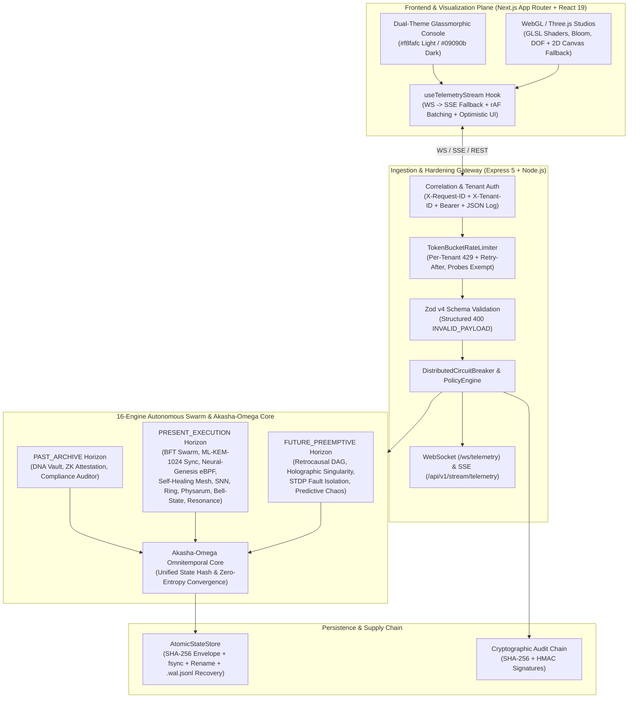
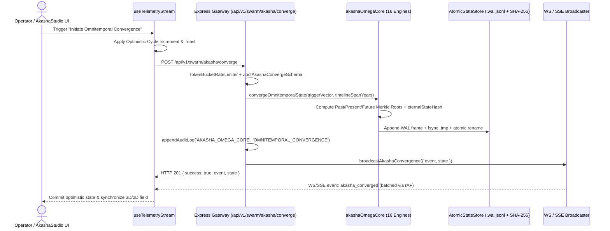

# Architecture — The Neon Chasm

This document details the **17 architectural layers**, **16 autonomous swarm & cryptographic engines**, and the **Akasha-Omega Omnitemporal Core** powering The Neon Chasm platform.

---

## High-Level System Topology

---

## The 17 Architectural Layers

| Layer | Domain | Primary Responsibilities | Key Modules |
| :---: | :--- | :--- | :--- |
| **1** | Presentation & Tokens | Dual-theme CSS tokens, sub-pixel antialiasing, chromatic glassmorphism, `/healthz` + `/readyz` widget | `src/styles/globals.css`, `src/components/system/HealthDashboard.tsx` |
| **2** | Spatial WebGL Visualizers | Custom GLSL holographic/particle shaders, GPU bloom/DOF, 2D fallback | `src/components/mesh/AkashaStudio.tsx` |
| **3** | Real-Time Transport Client | WS/SSE failover, RTT heartbeat, exponential backoff, rAF batching | `src/hooks/useTelemetryStream.ts` |
| **4** | Worker & Log Grid | Web Worker ingestion & virtualized high-throughput log explorer | `src/components/logs/AdvancedLogView.tsx` |
| **5** | Correlation, Tenant & Edge Defense | `X-Request-ID`, `X-Tenant-ID`, Bearer HMAC auth, per-tenant token bucket (`429`), Zod v4 (`400`) | `server/src/middleware/correlationAndTenant.ts`, `productionHardening.ts` |
| **6** | Resilience & Policy | Circuit breakers, eBPF throttlers, multi-tenant workspace guardrails | `server/src/middleware/circuitBreaker.ts`, `security/policyEngine.ts` |
| **7** | OTLP Ingestion & Streaming | OpenTelemetry batch ingestion, PromQL/LogQL & SSE/WS pub-sub | `server/src/index.ts`, `ws/gateway.ts`, `metrics/` |
| **8** | Incident & Causal Triage | Z-Score trace anomalies, Bayesian causal inference, post-mortems | `server/src/routes/incidents.ts`, `traces.ts` |
| **9** | Autonomous Remediation | Canary rollbacks, RL control loops, GitOps reconciliation | `server/src/routes/selfHealing.ts` |
| **10** | Continuous Governance | SOC2/GDPR posture linting, SIEM dispatch, FinOps, CBOM inventory | `server/src/routes/compliance.ts`, `governance/` |
| **11** | Cellular & DNA Vault | Synthetic DNA archival encoding & ZKP genomic privacy verification | `server/src/dna/dnaTelemetryVault.ts`, `zkpGenomicPrivacy.ts` |
| **12** | Post-Quantum Lattice Bus | ML-KEM-1024 telepathic swarm gossip & biophotonic Bell-state sync | `server/src/swarm/quantumSwarmSync.ts`, `crypto/biophotonicSync.ts` |
| **13** | Neuromorphic & Bio-Routing | SNN membrane prediction, STDP fault isolation, Physarum path routing | `server/src/ai/neuromorphicPredictor.ts`, `mesh/slimeMouldOptimizer.ts` |
| **14** | Neural-Genesis Kernel | Runtime eBPF XDP filter synthesis & JIT verification | `server/src/swarm/neuralGenesisKernel.ts` |
| **15** | Retrocausal & Chaos Twin | Preemptive DAG fault prevention & predictive chaos inoculation | `server/src/swarm/retrocausalFaultPrevention.ts`, `predictiveChaosSwarm.ts` |
| **16** | Akasha-Omega Core | 16-engine omnitemporal unification across Past, Present, Future | `server/src/swarm/akashaOmegaCore.ts` |
| **17** | Atomic WAL Persistence | Checksum-verified JSON snapshots, `.wal.jsonl` recovery, Merkle audit | `server/src/storage/statePersistence.ts` |

---

## The 16 Unified Swarm & Observability Engines

1. **Past Archive Horizon (`PAST_ARCHIVE`)**:
   - `dna-telemetry-vault` — Cellular DNA Telemetry Vault
   - `zk-swarm-attestation` — Zero-Knowledge Swarm Attestation
   - `continuous-compliance-auditor` — Continuous Compliance Auditor
2. **Present Execution Horizon (`PRESENT_EXECUTION`)**:
   - `sre-swarm-orchestrator` — Decentralized SRE Swarm BFT
   - `quantum-swarm-sync` — ML-KEM-1024 Telepathic Sync
   - `neural-genesis-kernel` — Neural-Genesis eBPF Kernel
   - `self-healing-mesh` — Autonomous Self-Healing Mesh
   - `neuromorphic-snn-predictor` — Neuromorphic SNN Predictor
   - `autonomous-mesh-ring` — Autonomous Mesh Ring Controller
   - `slime-mould-bio-router` — Physarum Bio-Routing Optimizer
   - `biophotonic-entanglement-sync` — Biophotonic CHSH Bell-State Sync
   - `neural-resonance-sync` — Neural Harmonic Resonance Sync
3. **Future Preemptive Horizon (`FUTURE_PREEMPTIVE`)**:
   - `retrocausal-fault-prevention` — Retrocausal Fault Prevention
   - `biophotonic-singularity-sync` — Holographic Singularity Sync
   - `neuromorphic-stdp-isolation` — Neuromorphic STDP Fault Isolation
   - `predictive-chaos-swarm` — Predictive Chaos Inoculation

---

## Omnitemporal Convergence & Atomic Persistence Flow

